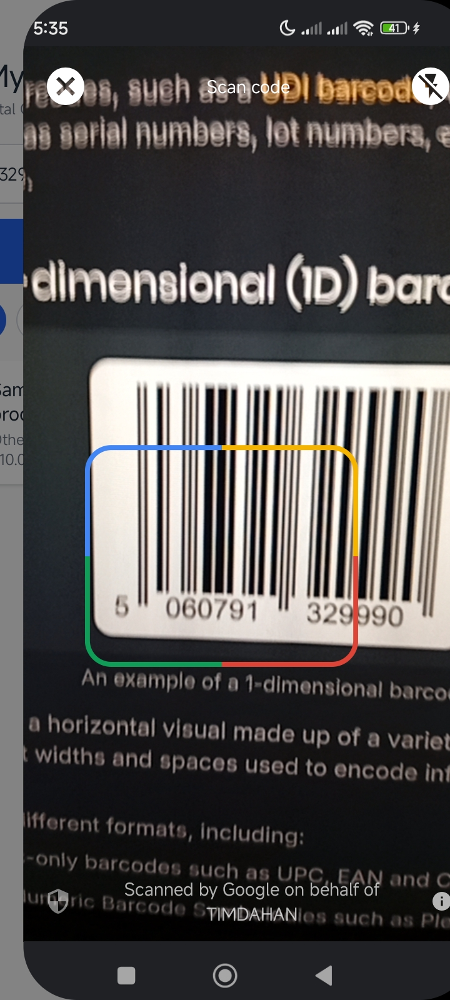
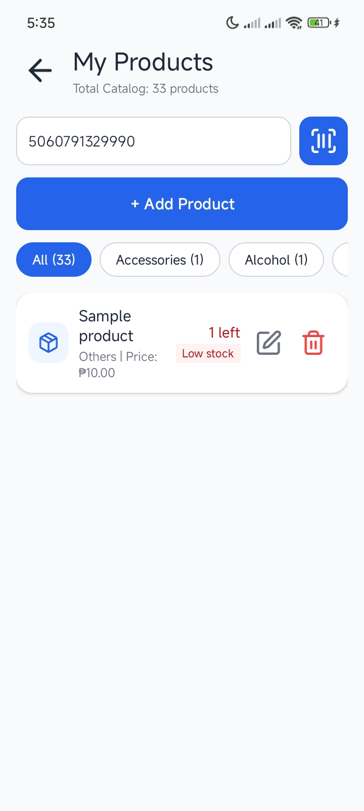
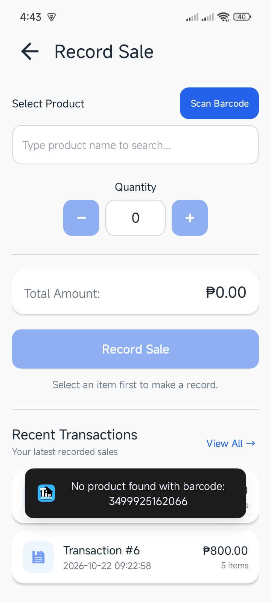
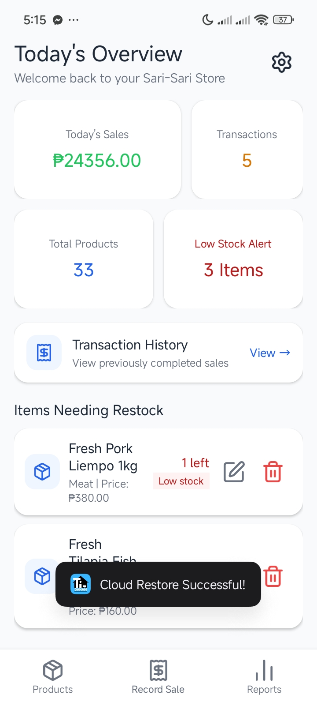
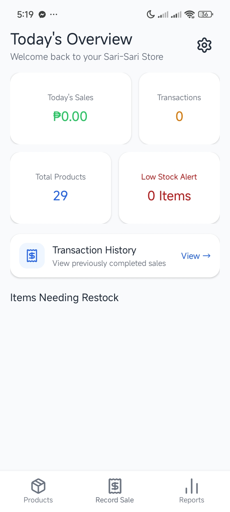
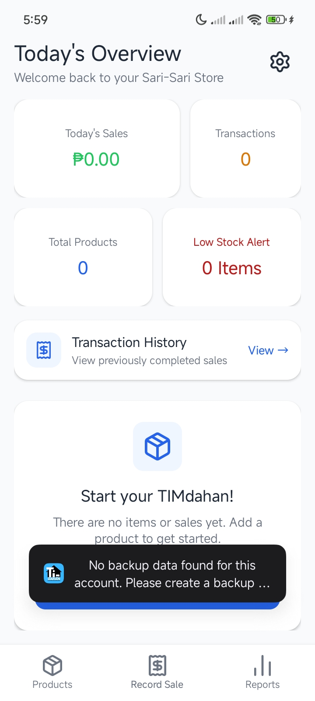
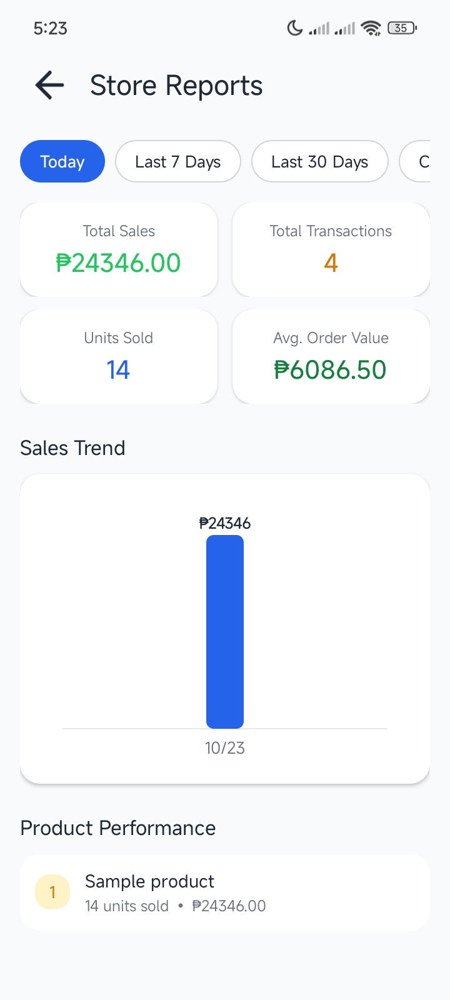
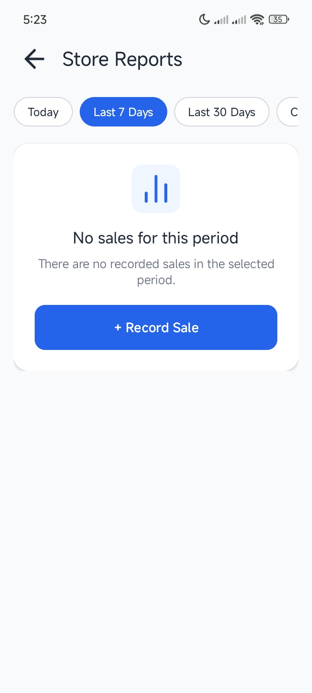

# TIMdahan: Sari-Sari Store Inventory & Point of Sale System

**TIMdahan** is an offline-first native Android application designed to help Filipino Sari-Sari store owners manage product inventory, execute point-of-sale (POS) checkout transactions, track daily sales analytics, and sync store data to the cloud.

---

## 📱 API Demonstration & Screenshots

Below are screenshots demonstrating the application's core APIs in both **Successful States** and **Error / Empty States**:

### 1. Google ML Kit Barcode Scanner API
> Used for on-device barcode scanning during inventory product creation and POS checkout.

| Successful Scan (Inventory & Checkout) | Error / Unregistered Barcode State |
| :---: | :---: |
|      |  |
| *Barcode scanned and product field populated* | *Unregistered barcode prompt / Not found error* |

---

### 2. Firebase Realtime Database Cloud Backup & Sync API
> Used for cloud store database backup, account restore, and multi-device synchronization.

| Successful Cloud Backup & Account Sync | Cloud Restore Error / Not Found State |
| :---: | :---: |
|      |  |
| *Cloud backup and account sync successful toasts* | *No cloud backup found for account error prompt* |

---

### 3. Analytics & Inventory Database API (`DatabaseHelper`)
> Used for SQLite offline persistence, POS sales transaction logging, and real-time report generation.

| Active Sales & Analytics State | Empty State (No Transactions) |
| :---: | :---: |
|  |  |
| *Sales trend line graph and best sellers ranking* | *Empty state screen when no sales transactions exist* |

---
